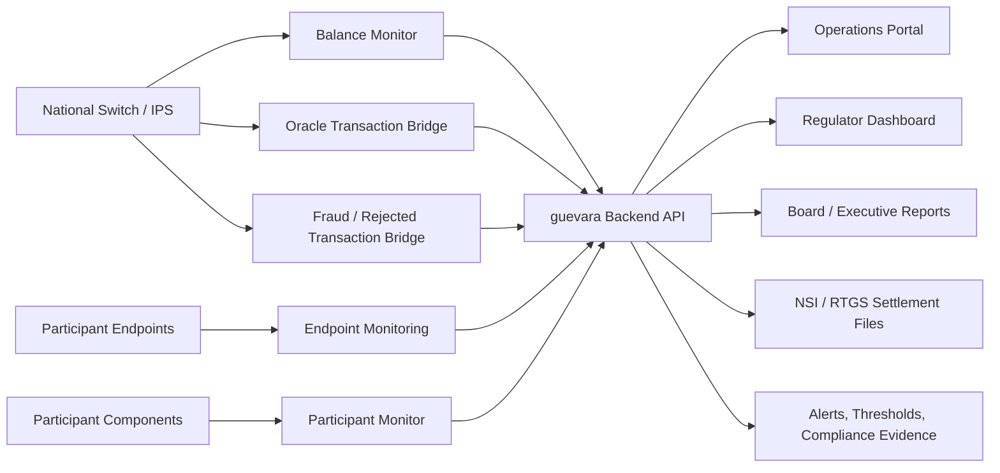

# Guevara

Guevara is the supervisory, settlement-intelligence, and
operational-governance backend for the Somali national switch. It provides the
controlled API layer used for switch health, participant readiness, liquidity
exposure, transaction outcomes, fraud and rejection patterns, settlement
files, and compliance evidence.

---

## Ownership, Authorship & Licensing

This repository is owned by **SOMALI PAYMENT SWITCH (SPS) LTD**.

**Technical leadership and implementation:** Guevara was designed, built,
deployed, and productionized by Abdulshakur Ahmed Aided
([@hanadderia](https://github.com/hanadderia)) within the Somali Payment Switch
institutional context.

This repository is released under the **Apache License 2.0**. See
[LICENSE](LICENSE) and [NOTICE](NOTICE).

Release governance is documented through:

- [NOTICE](NOTICE) - institutional copyright, attribution, and trademark notice.
- [THIRD_PARTY_NOTICES.md](THIRD_PARTY_NOTICES.md) - third-party and product-reference notices.
- [SECURITY.md](SECURITY.md) - vulnerability reporting and sensitive-material policy.
- [CONTRIBUTING.md](CONTRIBUTING.md) - contribution rules and high-risk review areas.
- [CODEOWNERS](CODEOWNERS) - institutional maintainers.

---

## National Switch Strategic Overview

## Executive Summary

guevara is the supervisory, settlement-intelligence, and operational-governance backend around the national switch. It does not replace the switch transaction engine. Instead, it gives the scheme operator, regulator, board, and participating institutions a controlled API layer for switch health, participant readiness, liquidity exposure, transaction outcomes, fraud/rejection patterns, settlement files, and compliance evidence.

Strategically, guevara helps move the national switch from a transaction-processing platform into a governed national payments utility. Its value is not only in dashboards, but in the operating discipline it creates around resilience, liquidity, settlement, participant accountability, and regulatory transparency.

## Strategic Position

The national switch is the transaction authority and settlement source of truth. guevara provides the surrounding control plane:

- It receives participant settlement balances and threshold conditions.
- It ingests processed, failed, and rejected transaction activity.
- It stores participant endpoint and component monitoring history.
- It generates and exposes NSI and RTGS settlement artifacts.
- It supports APIs for regulator, executive, operator, and participant-facing dashboards.
- It provides administrative governance for participants, users, roles, certificates, reports, downloads, and thresholds.

In practical terms, guevara is the switch control tower backend: it turns raw operational activity into decisions, evidence, alerts, and settlement outputs.

## End-to-End System View

## Subsystems

guevara is made of several operational subsystems. Together they make it the real operational surface for SOMALI PAYMENT SWITCH (SPS) LTD: the place where switch activity becomes supervision, settlement evidence, participant governance, liquidity control, and executive/regulatory intelligence.

### 1. Identity, Access, and Authorization

This subsystem controls who can enter the operational surface and what each user can do.

Key areas:

- Authentication and token lifecycle.
- Users, roles, claims, and permissions.
- Access boundaries for operational, administrative, reporting, and regulatory users.
- Query permissions for sensitive transaction, participant, certificate, NSI, and report data.

Primary modules:

- `Auth`
- `Users`
- `Roles`
- `Claims`
- `Permissions`

Strategic role: protects the national switch operating surface from becoming a flat dashboard. Sensitive functions are separated by responsibility and authority.

### 2. Participant Registry and Governance

This subsystem manages the institutions connected to the national switch and keeps participant identity available to the rest of the system.

Key areas:

- Participant records and lookup APIs.
- Live participant visibility.
- Participant-specific balance and operational status.
- Participant administration for scheme operations.

Primary modules:

- `Participants`
- `ParticipantThresholds`
- `Certificates`

Strategic role: turns participant management into an active governance function rather than a static directory.

### 3. Liquidity and Balance Monitoring

This subsystem receives settlement-balance snapshots from the external balance-monitoring service and evaluates them against configured participant thresholds.

Key areas:

- Balance webhook ingestion.
- Participant balance status.
- Liquidity zones and threshold evaluation.
- Evidence for participant follow-up and operational escalation.

Primary modules:

- `Balance`
- `Thresholds`
- `Participants`

Strategic role: gives SPS early warning of liquidity stress before it becomes a settlement or service-continuity incident.

### 4. Transaction Ingestion and Outcome Tracking

This subsystem records transaction outcomes from the switch-adjacent Oracle sources and webhook feeds.

Key areas:

- Processed transaction ingestion.
- Failed transaction ingestion.
- Oracle transaction batch ingestion.
- Fraud/rejected transaction ingestion.
- Transaction summary ingestion.

Primary modules and controllers:

- `BalanceController`
- `FailedTransactionsController`
- `ProcessedTransactionsController`
- `TransactionsController`

Strategic role: gives SPS a consolidated view of what succeeded, what failed, what was rejected, and where transaction risk is concentrating.

### 5. Failed Transaction Intelligence and Analytics

This subsystem turns failed/rejected transaction records into supervisory intelligence.

Key areas:

- Failed transaction listing and classification.
- Oracle failed transaction analytics.
- Institution, account, rejection-type, and trend analytics.
- Manual failed transaction notification workflows.
- Compliance-oriented failure reporting.

Primary modules:

- `TransactionAnalytics`
- `FailedTransactions`
- Oracle failed transaction analytics services and workers.

Strategic role: supports fraud operations, participant remediation, compliance monitoring, and evidence-based conversations with institutions.

### 6. Regulator Dashboard

This subsystem exposes the supervisory endpoints intended for regulator and high-level oversight surfaces.

Key areas:

- Real-time monitoring cards.
- Hourly transaction volume.
- Velocity alerts.
- Alert heatmaps.
- Participant availability dashboards.

Primary module:

- `RegulatorDashboard`

Strategic role: gives regulators a structured, current view of systemic performance, participant availability, and risk signals.

### 7. Board and Executive Dashboard

This subsystem supports executive-level visibility into the health, scale, and performance of the national payment ecosystem.

Key areas:

- Operational dashboard APIs.
- Board-level summaries.
- Transaction and participant performance indicators.
- Management reporting views.

Primary modules:

- `Dashboard`
- `Reports`

Strategic role: converts operational records into leadership intelligence for policy, investment, participant engagement, and national payments strategy.

### 8. NSI, Net Settlement, and RTGS File Operations

This subsystem connects instant-payment activity to formal settlement and reconciliation processes.

Key areas:

- NSI file listing and download.
- Settlement-day information.
- Settlement summary files.
- Participant-specific settlement detail files.
- Manual NSI creation.
- RTGS XML generation.

Primary modules:

- `NSI`
- `Downloads`
- Net settlement services and models.

Strategic role: provides the settlement evidence layer that connects switch operations to final settlement obligations.

### 9. Certificate and Trust Material Governance

This subsystem manages certificate visibility, download, and lifecycle workflows used by participants and operators.

Key areas:

- Certificate listing and details.
- Certificate download workflows.
- Certificate updates and removal.
- Expiration notification support.

Primary module:

- `Certificates`

Strategic role: supports the trust fabric around participant connectivity, secure operations, and scheme governance.

### 10. Monitoring History and Participant Availability

This subsystem stores operational monitoring pushed from external endpoint/component monitoring services.

Key areas:

- Institution endpoint availability history.
- Participant status history.
- Monitoring ingestion.
- Historical availability review.

Primary modules:

- `History`
- `Participants`
- Monitoring-related persistence models.

Strategic role: provides the audit trail for availability, downtime, and SLA discussions across the national payments ecosystem.

### 11. Reports and Market Intelligence

This subsystem produces richer analytical views over switch activity and participant behavior.

Key areas:

- System overview reports.
- Participant summaries.
- League tables.
- Directional flow analysis.
- Counterparty analysis.
- Fee distribution.
- Net position reporting.
- Concentration analysis.
- Trend packs and matrices.

Primary module:

- `Reports`

Strategic role: gives SPS the analytical layer needed to understand adoption, concentration, corridor behavior, participant performance, and market evolution.

### 12. Downloads and Evidence Distribution

This subsystem governs access to generated artifacts and operational evidence.

Key areas:

- Download records.
- NSI and settlement file delivery.
- Summary and participant-specific files.
- Controlled artifact retrieval.

Primary module:

- `Downloads`

Strategic role: makes evidence distribution controlled, auditable, and repeatable instead of manual and informal.

### 13. Audit, History, and Operational Traceability

This subsystem records operational history and supports traceability across user actions, monitoring events, and system workflows.

Key areas:

- History records.
- Auditable entities.
- Operational logs and persisted event traces.
- Token invalidation background work.

Primary modules:

- `History`
- Auditing models and persistence interceptors.
- Background workers.

Strategic role: gives SPS the record-keeping foundation needed for accountability, post-incident review, and regulator confidence.

### 14. API Gateway Surface

This subsystem is the external HTTP boundary for the operational platform.

Key areas:

- Versioned API endpoints.
- MediatR command/query routing.
- API response wrapping.
- Swagger/OpenAPI exposure.
- Request logging and exception handling.

Primary layer:

- `Apps/API`

Strategic role: presents guevara as a controlled institutional API surface rather than a collection of disconnected services.

## Core Capabilities

### 1. Liquidity and Settlement Risk Control

guevara receives participant settlement account balances from the balance-monitoring service and applies participant threshold logic to classify liquidity conditions into operational risk zones.

Strategic impact:

- Early warning when a participant is approaching a liquidity constraint.
- Better prevention of settlement disruption.
- More disciplined participant liquidity management.
- Stronger evidence for intervention, escalation, or participant follow-up.

For a national switch, transaction volume alone is not enough. The operator must also understand whether participants can continue to settle their obligations.

### 2. Transaction Visibility and Outcome Intelligence

guevara ingests transaction activity from Oracle-backed switch sources, including processed transactions and rejected/fraud-management transactions. It exposes failed transaction, processed transaction, transaction analytics, and regulator dashboard endpoints.

Strategic impact:

- Clearer visibility into successful, failed, and rejected transaction flows.
- Ability to identify concentration of failures by participant, account, rejection reason, or time window.
- Stronger fraud and exception monitoring.
- Better operational intelligence for root-cause analysis and policy review.

This turns the switch from a black-box transaction router into an observable national payments infrastructure.

### 3. Regulatory Oversight and Market Conduct Intelligence

The regulator dashboard APIs provide real-time monitoring cards, transaction volume by hour, velocity alerts, alert heatmaps, and participant availability information.

Strategic impact:

- Regulators can supervise systemic conditions using current operational evidence.
- The scheme operator can show objective indicators for transaction performance, failed transaction rates, suspicious velocity, and participant uptime.
- Compliance conversations can be based on data rather than manual reports or anecdotal escalation.

This is especially important where the national switch is becoming critical financial infrastructure.

### 4. Participant Availability Governance

guevara receives and stores monitoring history from services that check institution endpoints and participant components, classify failures, and push status updates.

Strategic impact:

- Faster detection of participant unavailability.
- Improved SLA enforcement and incident reconstruction.
- A shared operational truth between the scheme operator, regulator, and participants.
- Reduced ambiguity during national payment service incidents.

Participant availability is not only a technical concern. It is a market reliability and customer trust concern.

### 5. NSI and RTGS Settlement Artifacts

guevara contains NSI, net settlement, settlement summary, and RTGS XML generation capabilities. It exposes settlement files and participant-specific settlement detail files through controlled download endpoints.

Strategic impact:

- Connects real-time switch activity to formal settlement obligations.
- Improves reconciliation and participant settlement transparency.
- Supports controlled distribution of settlement evidence.
- Reduces manual handling around settlement file generation and retrieval.

This makes guevara a bridge between instant payment operations and final settlement processes.

### 6. Participant, Certificate, Role, and Permission Governance

guevara manages participants, certificates, users, roles, claims, thresholds, downloads, reports, history, and transaction access.

Strategic impact:

- Centralized governance of who can operate, view, download, or administer sensitive switch information.
- Better operational control over participant onboarding and certificate lifecycle.
- Clearer separation between operational, regulatory, reporting, and administrative users.
- Stronger auditability of actions and access.

For national switch infrastructure, governance is part of the product. The switch is trusted partly because its surrounding controls are trusted.

## Operating Model

guevara operates as the backend of a layered national-switch control environment:

1. The switch and related Oracle systems produce operational facts: balances, transactions, rejected transactions, fraud records, and settlement data.
2. Monitoring daemons collect live operational conditions from the switch, participant endpoints, and infrastructure components.
3. guevara normalizes this data, stores it, applies permissions, supports analytics, and exposes operational workflows.
4. The portal gives operators and scheme teams a controlled interface for daily work.
5. Dashboards and reports turn operational facts into oversight, regulatory, and executive intelligence.
6. NSI and RTGS outputs connect switch operations to settlement and reconciliation.

## Strategic Outcomes for the National Switch

### Resilience

guevara improves resilience by making participant and infrastructure failures visible early. It supports faster incident response and gives the operator historical evidence for post-incident review.

### Liquidity Safety

Balance ingestion and participant thresholds help identify liquidity stress before it becomes a settlement failure. This supports proactive intervention and participant accountability.

### Regulatory Confidence

The regulator dashboard and reporting APIs provide structured evidence of switch performance, participant availability, transaction outcomes, and alert conditions.

### Settlement Discipline

NSI and RTGS file generation connect real-time payment activity to formal settlement and reconciliation workflows. This strengthens confidence in end-of-day and participant-level settlement processes.

### Participant Accountability

Endpoint monitoring history, certificates, thresholds, roles, and participant administration give the scheme operator tools to manage participation as an active governance function, not as a static registry.

### Executive Intelligence

Reports and dashboards help leadership understand adoption, concentration, flows, operational risk, and systemic performance. This supports policy, investment, and participant-management decisions.

## Strategic Interpretation

The main value of guevara is that it creates a national payments operating picture. It combines switch activity, liquidity health, participant availability, fraud/rejection signals, settlement files, and governance controls into one supervisory backend.

That changes the strategic posture of the national switch:

- From reactive incident handling to proactive supervision.
- From fragmented operational data to a consolidated control plane.
- From manual settlement evidence to governed settlement artifacts.
- From basic participant registration to active participant governance.
- From limited regulatory visibility to continuous oversight.

In short, guevara strengthens the national switch as trusted financial-market infrastructure. It helps the operator run the switch with more resilience, more transparency, and more control.
