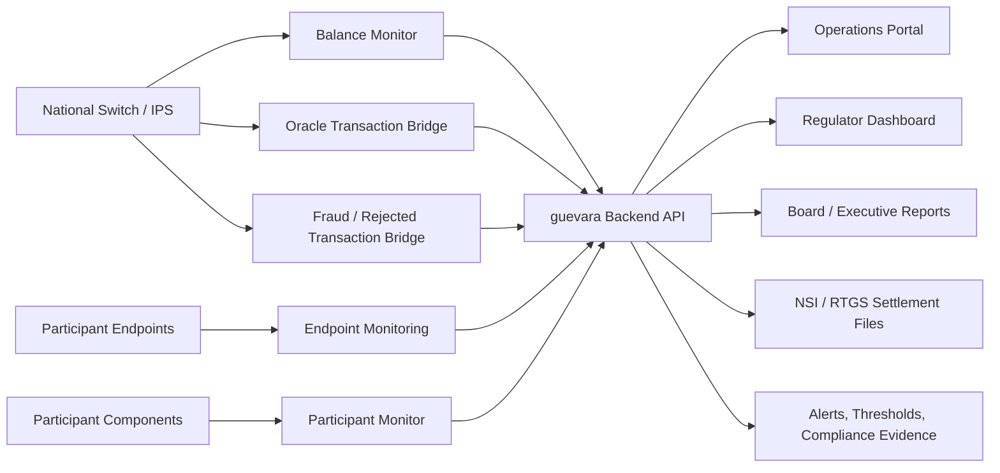

# guevara

## National Switch Strategic Overview

## Ownership and Stewardship

guevara is owned by SOMALI PAYMENT SWITCH (SPS) LTD. The system was designed, built, and maintained on behalf of the SOMALI PAYMENT SWITCH (SPS) LTD ecosystem.

Any public release, licensing decision, or third-party distribution should be made by SOMALI PAYMENT SWITCH (SPS) LTD or by parties formally authorized by SOMALI PAYMENT SWITCH (SPS) LTD.

## Executive Summary

guevara is the supervisory, settlement-intelligence, and operational-governance backend around the national switch. It does not replace the switch transaction engine. Instead, it gives the scheme operator, regulator, board, and participating institutions a controlled API layer for switch health, participant readiness, liquidity exposure, transaction outcomes, fraud/rejection patterns, settlement files, and compliance evidence.

Strategically, guevara helps move the national switch from a transaction-processing platform into a governed national payments utility. Its value is not only in dashboards, but in the operating discipline it creates around resilience, liquidity, settlement, participant accountability, and regulatory transparency.

## Strategic Position

The national switch is the transaction authority and settlement source of truth. guevara provides the surrounding control plane:

- It receives participant settlement balances and threshold conditions.
- It ingests processed, failed, and rejected transaction activity.
- It stores participant endpoint and component monitoring history.
- It generates and exposes NSI and RTGS settlement artifacts.
- It supports APIs for regulator, executive, operator, and participant-facing dashboards.
- It provides administrative governance for participants, users, roles, certificates, reports, downloads, and thresholds.

In practical terms, guevara is the switch control tower backend: it turns raw operational activity into decisions, evidence, alerts, and settlement outputs.

## End-to-End System View



## Core Capabilities

### 1. Liquidity and Settlement Risk Control

guevara receives participant settlement account balances from the balance-monitoring service and applies participant threshold logic to classify liquidity conditions into operational risk zones.

Strategic impact:

- Early warning when a participant is approaching a liquidity constraint.
- Better prevention of settlement disruption.
- More disciplined participant liquidity management.
- Stronger evidence for intervention, escalation, or participant follow-up.

For a national switch, transaction volume alone is not enough. The operator must also understand whether participants can continue to settle their obligations.

### 2. Transaction Visibility and Outcome Intelligence

guevara ingests transaction activity from Oracle-backed switch sources, including processed transactions and rejected/fraud-management transactions. It exposes failed transaction, processed transaction, transaction analytics, and regulator dashboard endpoints.

Strategic impact:

- Clearer visibility into successful, failed, and rejected transaction flows.
- Ability to identify concentration of failures by participant, account, rejection reason, or time window.
- Stronger fraud and exception monitoring.
- Better operational intelligence for root-cause analysis and policy review.

This turns the switch from a black-box transaction router into an observable national payments infrastructure.

### 3. Regulatory Oversight and Market Conduct Intelligence

The regulator dashboard APIs provide real-time monitoring cards, transaction volume by hour, velocity alerts, alert heatmaps, and participant availability information.

Strategic impact:

- Regulators can supervise systemic conditions using current operational evidence.
- The scheme operator can show objective indicators for transaction performance, failed transaction rates, suspicious velocity, and participant uptime.
- Compliance conversations can be based on data rather than manual reports or anecdotal escalation.

This is especially important where the national switch is becoming critical financial infrastructure.

### 4. Participant Availability Governance

guevara receives and stores monitoring history from services that check institution endpoints and participant components, classify failures, and push status updates.

Strategic impact:

- Faster detection of participant unavailability.
- Improved SLA enforcement and incident reconstruction.
- A shared operational truth between the scheme operator, regulator, and participants.
- Reduced ambiguity during national payment service incidents.

Participant availability is not only a technical concern. It is a market reliability and customer trust concern.

### 5. NSI and RTGS Settlement Artifacts

guevara contains NSI, net settlement, settlement summary, and RTGS XML generation capabilities. It exposes settlement files and participant-specific settlement detail files through controlled download endpoints.

Strategic impact:

- Connects real-time switch activity to formal settlement obligations.
- Improves reconciliation and participant settlement transparency.
- Supports controlled distribution of settlement evidence.
- Reduces manual handling around settlement file generation and retrieval.

This makes guevara a bridge between instant payment operations and final settlement processes.

### 6. Participant, Certificate, Role, and Permission Governance

guevara manages participants, certificates, users, roles, claims, thresholds, downloads, reports, history, and transaction access.

Strategic impact:

- Centralized governance of who can operate, view, download, or administer sensitive switch information.
- Better operational control over participant onboarding and certificate lifecycle.
- Clearer separation between operational, regulatory, reporting, and administrative users.
- Stronger auditability of actions and access.

For national switch infrastructure, governance is part of the product. The switch is trusted partly because its surrounding controls are trusted.

## Operating Model

guevara operates as the backend of a layered national-switch control environment:

1. The switch and related Oracle systems produce operational facts: balances, transactions, rejected transactions, fraud records, and settlement data.
2. Monitoring daemons collect live operational conditions from the switch, participant endpoints, and infrastructure components.
3. guevara normalizes this data, stores it, applies permissions, supports analytics, and exposes operational workflows.
4. The portal gives operators and scheme teams a controlled interface for daily work.
5. Dashboards and reports turn operational facts into oversight, regulatory, and executive intelligence.
6. NSI and RTGS outputs connect switch operations to settlement and reconciliation.

## Strategic Outcomes for the National Switch

### Resilience

guevara improves resilience by making participant and infrastructure failures visible early. It supports faster incident response and gives the operator historical evidence for post-incident review.

### Liquidity Safety

Balance ingestion and participant thresholds help identify liquidity stress before it becomes a settlement failure. This supports proactive intervention and participant accountability.

### Regulatory Confidence

The regulator dashboard and reporting APIs provide structured evidence of switch performance, participant availability, transaction outcomes, and alert conditions.

### Settlement Discipline

NSI and RTGS file generation connect real-time payment activity to formal settlement and reconciliation workflows. This strengthens confidence in end-of-day and participant-level settlement processes.

### Participant Accountability

Endpoint monitoring history, certificates, thresholds, roles, and participant administration give the scheme operator tools to manage participation as an active governance function, not as a static registry.

### Executive Intelligence

Reports and dashboards help leadership understand adoption, concentration, flows, operational risk, and systemic performance. This supports policy, investment, and participant-management decisions.

## Strategic Interpretation

The main value of guevara is that it creates a national payments operating picture. It combines switch activity, liquidity health, participant availability, fraud/rejection signals, settlement files, and governance controls into one supervisory backend.

That changes the strategic posture of the national switch:

- From reactive incident handling to proactive supervision.
- From fragmented operational data to a consolidated control plane.
- From manual settlement evidence to governed settlement artifacts.
- From basic participant registration to active participant governance.
- From limited regulatory visibility to continuous oversight.

In short, guevara strengthens the national switch as trusted financial-market infrastructure. It helps the operator run the switch with more resilience, more transparency, and more control.

## Licensing Recommendation

Recommended license: Apache License 2.0, provided SOMALI PAYMENT SWITCH (SPS) LTD formally owns the code and authorizes its open-source release.

Apache-2.0 fits guevara because it is enterprise-friendly, widely understood, permits commercial adoption, preserves attribution through a `NOTICE` file, includes an explicit patent grant, limits trademark permission, and includes warranty and liability disclaimers.

Why Apache-2.0 fits SOMALI PAYMENT SWITCH (SPS) LTD:

- Banks and integrators can adopt it without opening their entire technology stack.
- SOMALI PAYMENT SWITCH (SPS) LTD remains visibly attributed.
- Contributors provide explicit copyright and patent permissions.
- Recipients must preserve relevant notices.
- SOMALI PAYMENT SWITCH (SPS) LTD names and trademarks are not freely licensed.
- It supports national and regional ecosystem adoption with low procurement friction.

The trade-off is important: third parties may fork, modify, and commercially deploy the software without returning their improvements.

| Strategic objective | Best choice |
| --- | --- |
| Maximum institutional and commercial adoption | Apache-2.0 |
| Require distributed changes to existing files to remain open | MPL-2.0 |
| Require hosted/network modifications to be published | AGPL-3.0 |
| Public evidence only; no permission to reuse | No license / all rights reserved |

MPL-2.0 is the second-best option if SOMALI PAYMENT SWITCH (SPS) LTD wants file-level improvements shared while still allowing banks to combine the platform with proprietary systems. AGPL-3.0 is not recommended for this ecosystem because many banks and enterprise vendors treat its network-source requirement as procurement friction.

Apache-2.0 is preferred over MIT for this project because Apache provides explicit patent terms, structured attribution, and trademark boundaries, which are useful for mission-critical payment infrastructure.

## Before Applying a License

Do not add the license under an individual maintainer's personal name. The licensor must be the actual copyright owner or an entity authorized by that owner. Apache-2.0 grants perpetual, worldwide, and effectively irrevocable rights to released versions, so this decision should not be treated as a reversible experiment.

Before licensing, SOMALI PAYMENT SWITCH (SPS) LTD should verify:

- Written institutional authorization to open-source the repository.
- Copyright ownership of employee and contractor contributions.
- No BPC, SmartVista, or other proprietary source, configuration, or documentation.
- Licensing rights for ISO 20022 schemas and generated artifacts.
- Compatibility of all third-party dependencies.
- No credentials, production data, or sensitive history.
- Correct SOMALI PAYMENT SWITCH (SPS) LTD legal entity name for copyright notices.

Until that review is complete, leaving the repository without an open-source license is safer because default copyright restrictions continue to apply.

## Files to Add Before Open Source Release

If SOMALI PAYMENT SWITCH (SPS) LTD approves open-source release under Apache-2.0, the repository should include:

- `LICENSE` — unmodified Apache License 2.0 text.
- `NOTICE` — SOMALI PAYMENT SWITCH (SPS) LTD legal name, copyright years, and attribution.
- `THIRD_PARTY_NOTICES.md` — third-party components and their licenses.
- `SECURITY.md` — private vulnerability-reporting process.
- `CONTRIBUTING.md` — contribution and ownership rules.
- `CODEOWNERS` — institutional maintainers.

Suggested `NOTICE` foundation:

```text
guevara
Copyright 2024-2026 SOMALI PAYMENT SWITCH (SPS) LTD

Developed and maintained as part of the Somali Instant Payment System
technology ecosystem.

SmartVista and other third-party product names are trademarks of their
respective owners. No trademark license is granted.
```
